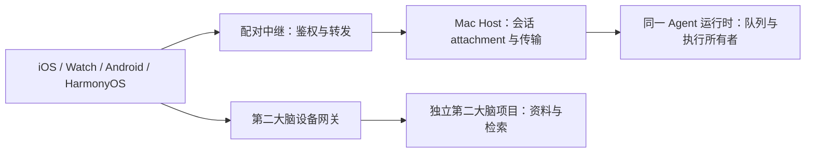

# LeoBot 架构与边界

## 所有者

- Agent runtime 持有任务、消息、工具、权限和恢复状态；UI 仅显示投影和未提交草稿。Host 与中继不另起业务队列或复制接受真相。
- 桌面连续流与手机可补拉恢复是两种交付语义；它们读取同一运行时/权限所有者，保留 owner、lease、run 与 workspace identity。
- 内置屏幕写操作的强审批由内核给出结构化禁止模式代答标记；事件、schema、恢复投影和 Host 自动出口必须保留该标记。UI 名称或 full-auto 模式不是授权来源。
- Electron main 处理原生资源、窗口与 IPC；特权操作只接受可信应用顶层 frame。外部文件以真实路径及类型验证，不能借错误解析或符号链接改成执行程序。

## 第二大脑

资料与网关属于独立第二大脑项目，不在此仓保存资料语料或凭据。本仓维护设备 API 客户端、确认过的响应模型及展示。公共文档只写逻辑角色；私有服务器地址、源码位置和 token 引用按用户本机既有配置维护。

原生资料检索/正文使用受限设备凭据；App 空间权限与模型可用资料范围不是同一概念。不能为了合并客户端而降低原有隐私校验。

每个读取周期绑定资源、连接配置和代际；取消、隐藏、换文档/连接使旧结果失效。正文与可选元数据独立到达，分页按已接受的响应推进。鉴权 header、page token 与重定向必须属于同一份请求配置。

浏览器的本机文件通路由原生会话上下文授权，URL 内容不能自报任意会话身份。受保护会话不向跨会话工具暴露；普通已解锁会话中的用户对话仍走原工作流。

## 配置、发行与数据

- 唯一权威源码为 main；远端 worker 只有具备来源 SHA 的受控构建快照，安装以签名包和源码记录对应。
- 各平台发布身份保持稳定，开发编译、签名和实际安装分别记录。版本对应自己的更新说明，源码 HEAD 可能含下一批未装开发内容。
- 私有机群分发与公开发行必须明确区分，不自动上传二进制或修改仓库可见性。
- 本轮用户接管功能、界面及性能测试；助手只执行必要编译、签名、版本和安装检查，不以编译替代验收。
- 现有备份、资料目录、数据库、同步冲突、持久缓存与清理策略保持原样；本轮不引入数据迁移。
