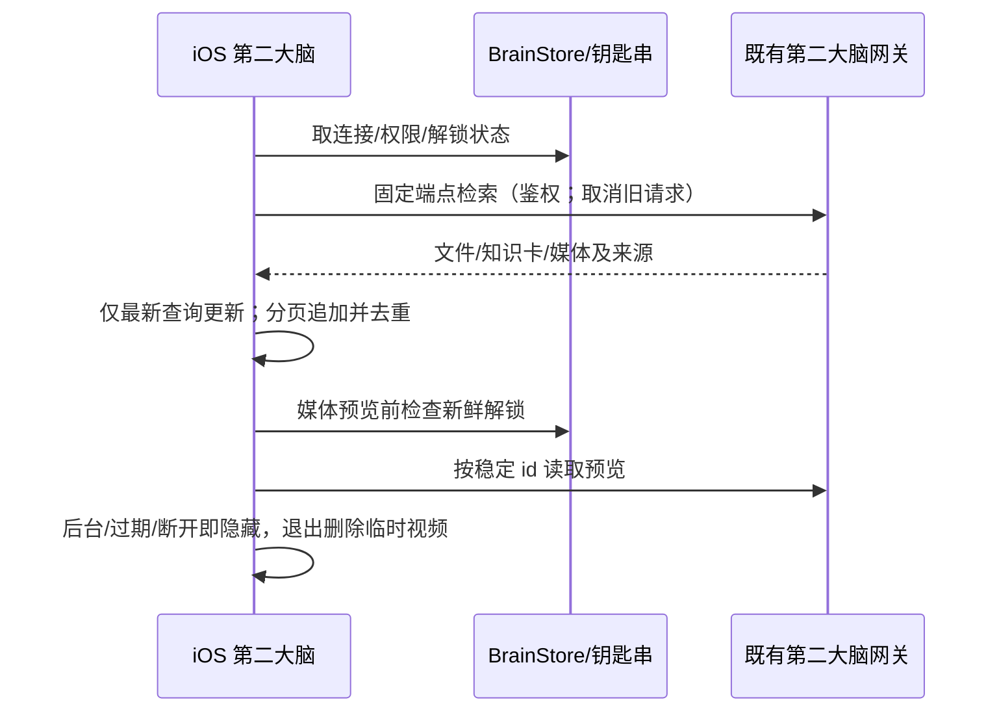

# iOS 第二大脑入口与模型选择升级

## 范围
Pro Max / Duo / iPad 原生界面；第二大脑服务只读接入，不改后端、数据库、布布时光机或家庭媒体。旧收藏与工具协议保留。

## 行为
- 藏宝阁主入口变为第二大脑工作区。搜索为主操作；全库结果在首屏，本机收藏保留独立入口。文件、图片、视频、知识卡可直接选择。
- 文档/卡片复用 /v1/search、cards、files/chunks。空关键词不伪造远端全库列表（网关拒绝空词），首页明确搜索引导并提供知识卡与媒体浏览。
- 媒体仅经现有 BrainClient 的鉴权、同源限制访问 /v1/media；不信任响应内 URL，始终按 id 构造固定路径。图片/视频要求本机解锁和 private 权限，权限缺失不当作零结果。锁过期、后台或断开后隐藏媒体。预览不写公共相册、不交模型，临时视频退出后清除。
- 文档可明确「引用到对话」，引用经 untrusted treasuryContext，不将检索内容当用户指令；私密文件和媒体不传给云端模型。
- 常用模型：当前实际模型 ID 独立显示；常用直接点选，搜索/全部模型次级导航。分组管理藏于次级入口。草稿选择不创建会话、不改默认；切换失败保留原绑定。
- 当前模型 ID 主显示。分组不抢占模型空间；loadBalance 在无会话时明确「发送时自动选模」，不可假报具体模型。

## 状态与所有者

## 验收
真实源码编译、端点/隐私/分页/模型身份回归、Pro Max/Duo/iPad 横竖屏截图与交互；失败与无权限/未连接可恢复。Air Astra 审计方案和最终 diff。没有真实证据不得宣称真机或全库功能通过。装机必须递增版本、更新说明并走 InstallIOSRelease.sh。
